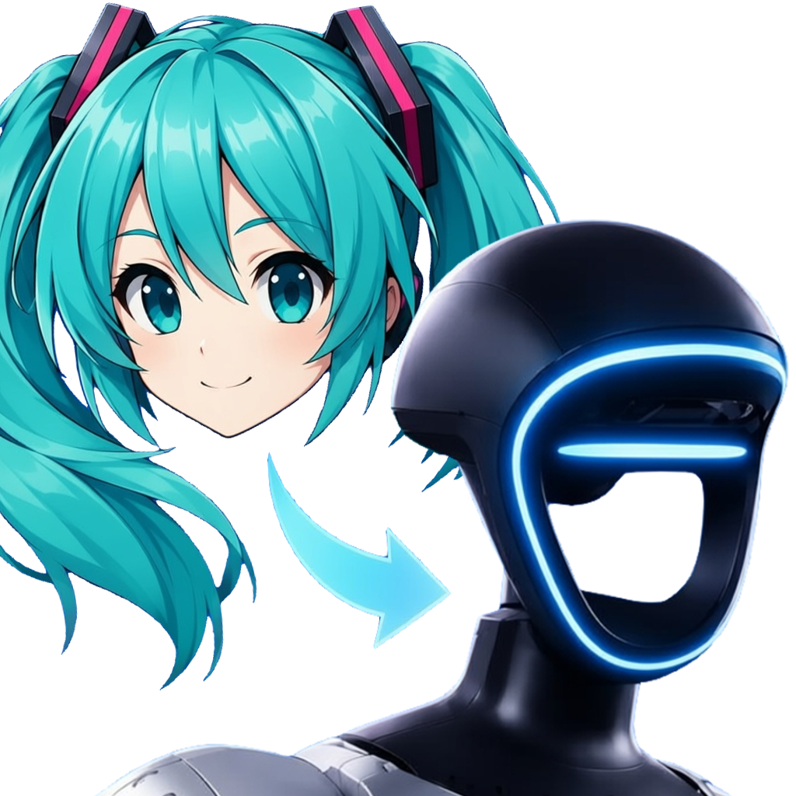

#  MMDMR (miku-to-humanoid)

把 MMD 模型（PMX）的动作（VMD/VPD）重定向到人形机器人上。形变管线直接给出每根骨的世界位姿，标定出「MMD 骨坐标系 ↔ 机器人链接坐标系」的固定关系 C，再由
GMR 的 IK 解出机器人 qpos。

机器人侧只输出 qpos 与 pickle，不掺渲染用的中间件。

MMD 引擎解析借鉴 [yohawing/mmd-anim](https://github.com/yohawing/mmd-anim) 与
[masaka1024/mmd2gltf-gui](https://github.com/masaka1024/mmd2gltf-gui)（`src/mmdmr/mmd/` 为 vendored）。计划编写 rust 后端，采用 mmd-anim 为直接 rust 依赖。

## 预览

https://github.com/user-attachments/assets/50415e94-0bda-4738-a990-2a1fd74c138a

## 安装

```powershell
uv sync            # 以可编辑方式安装 mmdmr，并得到下面 4 个命令
```

GMR 是**独立 checkout**（不是 PyPI 包），重定向那一步必须跑在它自己的 venv 里；`--gmr-root` 默认
`D:\MY_TOOL\GitHub_Tools\GMR`，路径不同就改它。GUI 会自动调用 `<gmr-root>\.venv\Scripts\python.exe`。

## 四个命令

| 命令 | 作用 |
|---|---|
| `uv run mmdmr-gui` | 启动面板：**校准 → 重定向 → 预览**，一条龙 |
| `uv run mmdmr-calibration` | 批处理：求解配对姿态（`--solve`，可省略）并读出**中性 C** |
| `uv run mmdmr-retarget` | 唯一认识 GMR 配置格式的地方：中性 C + 引擎模板 → 机器人 qpos；`--view` 弹预览 |
| `uv run mmdmr-view` | 并排播放**源动作**与**结果 qpos**（不画中间表示） |

```powershell
# 1) 校准：从 VPD 解出配对姿态，再读 C（两个产物一起写）
uv run mmdmr-calibration --pmx assets\<模型>.pmx --robot configs\robots\t1.json `
    --vpd assets\default.vpd --solve `
    --pose-out configs\generated\paired_pose_t1.json `
    --out configs\generated\calibration_t1.json

# 2) 重定向（跑在 GMR 自己的解释器里）
<gmr>\.venv\Scripts\python.exe -m mmdmr.retarget --pmx assets\<模型>.pmx --vmd assets\丘丘摇.vmd `
    --robot configs\robots\t1.json --calibration configs\generated\calibration_t1.json `
    --bake-out runtime\t1.npz --view

# 3) 只看结果
uv run mmdmr-view --pmx assets\<模型>.pmx --pose assets\丘丘摇.vmd `
    --robot configs\robots\t1.json --robot-qpos runtime\t1.npz --offset 1.6 --loop
```

GUI 的三个按钮对应上面两步加一个预览，另外负责填路径；窗口默认贴屏幕右侧，拉宽时输入框与日志一起变宽。

## 数据流

```
PMX + (VMD|VPD)
   │  mmd/bake.py（vendored mmd2gltf 形变管线，源侧唯一入口，不碰 MuJoCo）
   ├──→ 逐帧骨骼世界位姿 {骨名: [pos, quat]}          ← GMR 的 human_data 形状
   │        │
   │        └─ calibration.py ──→ 中性 C: {scale, links: {链接: C_quat}}
   │                                          │
   └──→ mmd/mjcf.py（PMX → MjModel，纯内存）  │
            │                                  ▼
            └─ view.py（角色 + 机器人 + 骨架）   retarget.py（GMR IK，唯一认识 GMR 格式）
                                                  │
                                                  └──→ 机器人 qpos ── export_gmr_pickle.py ──→ .pkl
```

## 目录

```
src/mmdmr/
├── mmd/                MMD 侧引擎（vendored）：pmx vmd vpd mathutil animation bake basis mesh msh mjcf
│   └── constraints.py  MMD 事实（标准骨名）与项目选择（带权重的 SEGMENT_BONES）
├── config.py           机器人 profile 的格式 / 加载 / 校验（不认识 GMR）
├── calibration.py      场景 + 目标函数 + 求解；read_c() 产出中性 C
├── retarget.py         引擎适配：模板 + C → GMR 配置 → qpos（--view 预览三层）
├── view.py             MuJoCo 窗口与 overlay（QposOverlay / SkeletonOverlay / ChainOverlay）
└── gui.py              启动面板 + 校准窗
scripts/                get_robot_profile_from_gmr.py（生成 profile）、export_gmr_pickle.py
configs/                见下
assets/                 模型与动作（**未入库**，见 .gitignore）
```

## 配置：三种东西，别混

| 目录 | 内容 | 谁维护 |
|---|---|---|
| `configs/robots/<robot>.json` | **引擎无关**：`links`（链接↔MMD 骨）、`segments`、`root_links`、`bilateral_links`、`xml`，外加一行 `gmr_config` 指向引擎配置 | 手写，或用生成器写出 |
| `configs/gmr/<robot>.json` | **GMR 专属**：`ik_match_table1/2`（`[骨名, pos_w, rot_w, pos_offset, C_quat]`）、`robot_root_name`、`human_root_name`、`ground_height`、`use_ik_match_table1/2` | 生成器写出；换引擎时整个作废 |
| `configs/generated/*.json` | **产物**：配对姿态、中性 C | 不要手改，随时可重算 |

**中性 C 是绑在「PMX × 机器人」这一对上的**，不是机器人的属性：C 由源骨架的绑定姿态与配对姿态共同决定。
实测同一个 T1 profile，换一个 PMX（`頭` 高 1.2643 m ↔ 1.0431 m）会让 scale 从 0.7948 变 0.9633、脚与小腿
的 C 差到 7°。所以 `calibration_<robot>.json` 里记录了 `source_model`（文件名 + 路径）与 `heights.source`，
重算时必须用同一个 PMX，否则数值不可比。

换一台 GMR 支持的机器人（零手写）：

```powershell
uv run python scripts/get_robot_profile_from_gmr.py --robot booster_t1_29dof `
    --gmr-root <gmr> --out configs/robots/t1.json --gmr-out configs/gmr/t1.json
# G1 的权重与 GMR 出厂不同，需要显式列出偏离：
#   --override pelvis.rot_w=10 --override left_elbow_link.pos_w=0 ...
```

## 数学（全部内容）

```
目标   T_link(t) = S_bone(t) · C
标定   C = S_bone(P)⁻¹ · T_link(P)          P 是配对姿态
```

MMD 骨**没有静止旋转**，所以在配对姿态下每个骨坐标系都是恒等，C 退化成一次「读数」而不是拟合。

- **配对姿态**用**肢体方向**判定（8 条方向相等），因为朝向本身就是被标定的量；方向不随扭转变，代价是解
  存在扭转零空间，靠 ridge（`1e-6·Σq²`）保证确定性。
- **尺度**是一个均匀比例：机器人身高 / 源 `頭` 骨高度。
- 根与躯干两个链接不受肢体姿态约束，用**髋线**（`左足/右足` 对应链接的连线）给出世界 yaw。

## 验收基线（本机实测）

| 项 | 数值 |
|---|---|
| PMX 路线的 C 与已验收 glTF 路线 | `C_pmx = Rx90 · C_glb`，12 条肢体 **0.0°** |
| 端到端（PMX vs glTF）关节角 | 中位 **1.05°**，最大 **16.96°** |
| 从姿态重读 C 的复现性 | 角度 **0.000e+00°**，四元数元素 **2.2e-16** |
| 重定向复现 | 最大 **1.489e-13 rad** |
| 预览三层 | mmd **512** 关节槽 / robot **28** / 中间表示 **13** 条边 |

## 已知限制（实测结论，不是猜测）

- **手指级重定向未支持**：GMR 的 IK 没有手指目标，G1 29dof 也没有手指关节；MMD 的 38 根手指骨被有意丢弃
  （`SEGMENT_BONES` 预留了带权重的段位，启用前得先有机器人手指关节与拓扑映射）。
- **MMD 双层材质**（`X` 与 `X+`）空间重合会 z-fighting，当前以半透明叠加渲染；细节见 `mmd/mesh.py`。
- **`assets/` 未入库**（`.gitignore`），profile 里的 `..\..\assets\...` 在新克隆里会失效。
- GMR 必须用它自己的 venv；`mmdmr` 在那边不可见，GUI 会给子进程设 `PYTHONPATH=<repo>/src`。
